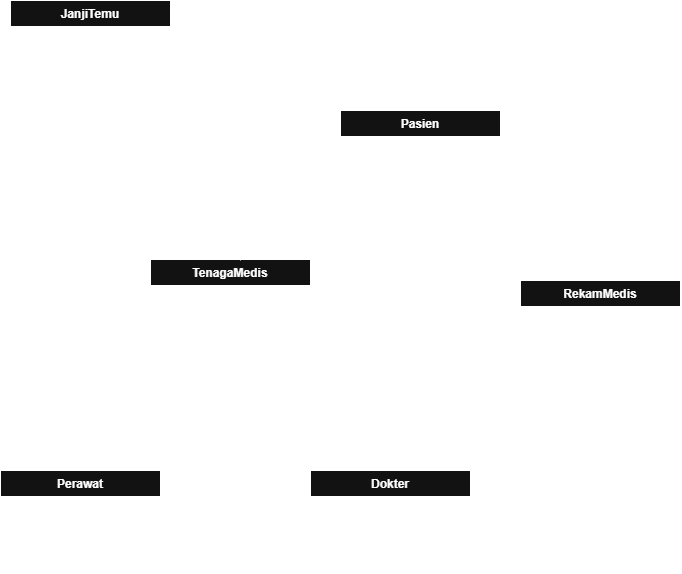
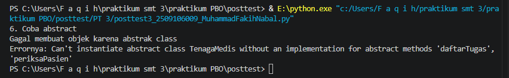
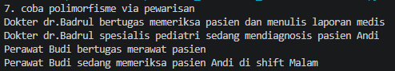
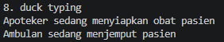
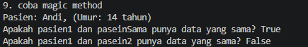

# **Program ini adalah simulasi Sistem manajemen dan layanan rumah sakit berbasis OOP sistem ini dirancang untuk mengelola data tenaga medis, pasien dan janji temu di rumah sakit**

- Asosiasi

Class: dari kelas Pasien ke JanjiTemu

Dokter berinteraksi dengan pasien hanya saat proses pemeriksaan, Kedua class ini tetap ada meski tidak sedang berinteraksi.

- Agregasi

Dari kelas Pasien & TenagaMedis ke janjiTemu

JanjiTemu berfungsi sebagai wadah untuk mengghubungkan Pasien dan TenagaMedis, jika JanjiTemu dihapus objek Pasien dan TenagaMedis tetap ada.

- Komposisi

Class: dari RekamMedis ke Pasien

Objek RekamMedis dibuat lansung di dalam Pasien, jika Pasien di hapus maka RekamMedis akan ikut terhapus.

- Inheritance

Class: Dokter & Perawat ke TenagaMedis 

Kedua kelas ini berbagi atribut nama, peran, dan idTenagaMedis.

# Program ini menerapkan abstraksi dan polimorfisme.

**#Abstraksi**

Membuat 1 kelas abstrak dengan 2 abstractmethod dan memiliki 1 method konkret

class TenagaMedis memiliki 2 abstrakmethod (periksaPasein dan daftarTugas) dan 1 method konkret.

    class TenagaMedis(ABC):
        def __init__(self,nama,peran,idTenagaMedis):
            self._nama = nama #protected
            self.peran = peran
            self.__idTenagaMedis = idTenagaMedis #private
    
        def getId(self):  #method konkret
            return self.__idTenagaMedis
    
        # Asosiasi
        @abstractmethod #polimorfime via pewarisan
        def periksaPasien(self, pasien):
            pass
    
        @abstractmethod #polimorfime via pewarisan
        def daftarTugas(self):
            pass
    #subclass
    class Dokter(TenagaMedis):
        def __init__(self, nama, peran,spesialis,idTenagaMedis):
            super().__init__(nama, peran,idTenagaMedis)
            self.spesialis = spesialis
    
        #overriding
        def periksaPasien(self, pasien):
            print(f"Dokter {self._nama} spesialis {self.spesialis} sedang mendiagnosis pasien {pasien.nama}")
            
        # abstract
        def daftarTugas(self):
            print(f"Dokter {self._nama} bertugas memeriksa pasien dan menulis laporan medis")

**#Polimorfisme**
- Polimorfisme via pewarisan

class TenagaMedis memiliki 2 method (periksaPasein dan daftarTugas) yang di-override oleh 2 subclass dengan objek yang berbeda lewat satu loop.

    class TenagaMedis(ABC):
        def __init__(self,nama,peran,idTenagaMedis):
            self._nama = nama #protected
            self.peran = peran
            self.__idTenagaMedis = idTenagaMedis #private

        @abstractmethod #polimorfime via pewarisan
        def periksaPasien(self, pasien):
            pass
    
        @abstractmethod #polimorfime via pewarisan
        def daftarTugas(self):
            pass

    class Dokter(TenagaMedis):
        def __init__(self, nama, peran,spesialis,idTenagaMedis):
        super().__init__(nama, peran,idTenagaMedis)
        self.spesialis = spesialis
    
        #overriding
        def periksaPasien(self, pasien):
            print(f"Dokter {self._nama} spesialis {self.spesialis} sedang mendiagnosis pasien {pasien.nama}")
            
        # abstract
        def daftarTugas(self):
            print(f"Dokter {self._nama} bertugas memeriksa pasien dan menulis laporan medis")

    class Perawat(TenagaMedis):
        def __init__(self, nama, peran,shift,idTenagaMedis):
        super().__init__(nama, peran,idTenagaMedis,)
        self.shift = shift
    
        # abstract
        def daftarTugas(self):
            print(f"Perawat {self._nama} bertugas merawat pasien")
        # abstract
        def periksaPasien(self, pasien):
            print(f"Perawat {self._nama} sedang memeriksa pasien {pasien.nama} di shift {self.shift}")
        
- memanggil dengan satu loop

        print("7. coba polimorfisme via pewarisan")
        pekerjaRS = [dokter,perawat]
        
        for pekerja in pekerjaRS:
            pekerja.daftarTugas()   
            pekerja.periksaPasien(pasien1)

- Duck Typing 

Membuat class Ambulan dan Apotek yang tidak berhubungan lewat pewarisan tapi keduanya punya method Layanan, kemudian memanggilnya dengan fungsi yang sama.

    class Ambulan:
        def Layanan(self):
            print("Ambulan sedang menjemput pasien")
    
    class Apotek:
        def Layanan(self):
            print("Apoteker sedang menyiapkan obat pasien")
    
    def JalankanLayanan(unit):
        unit.Layanan()
    
    print("8. duck typing")
    JalankanLayanan(Apotek())
    JalankanLayanan(Ambulan())

- Magic Method

Menerapkan 2 magic method __str__ dan __eq__

        def __str__(self):
            return f"Pasien: {self.nama}, (Umur: {self.umur} tahun)"
    
        def __eq__(self,other):
            if isinstance(other, Pasien):
                return self.nama == other.nama and self.umur == other.umur
            return False

